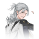
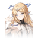
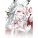
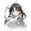
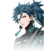
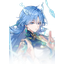
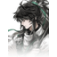
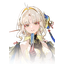

# Wuthering Waves character codenames

Role IDs may be shared across Rover variants.

| Portrait | In-game name | Code name | Role ID | Evidence |
| --- | --- | --- | --- | --- |
|  | Aalto | `qiushui` | 1403 | Game texture table + role ID |
|  | Aemeath | `AiMiSi` | 1210 | Game texture table + role ID |
|  | Augusta | `Aogusita` | 1306 | Game texture table + role ID |
|  | Baizhi | `bailian` | 1103 | Game texture table + role ID |
|  | Brant | `bulante` | 1206 | Game texture table + role ID |
|  | Buling | `BuLing` | 1307 | Game texture table + role ID |
|  | Calcharo | `kakaluo` | 1301 | Game texture table + role ID |
|  | Camellya | `chun` | 1603 | Game texture table + role ID |
|  | Cantarella | `kanteleila` | 1607 | Game texture table + role ID |
|  | Carlotta | `kelaita` | 1107 | Game texture table + role ID |
|  | Cartethyia | `katixiya` | 1409 | Game texture table + role ID |
|  | Changli | `changli` | 1205 | Game texture table + role ID |
|  | Chisa | `QianXiao` | 1508 | Game texture table + role ID |
|  | Chixia | `maxiaofang` | 1202 | Game texture table + role ID |
|  | Ciaccona | `xiakong` | 1407 | Game texture table + role ID |
|  | Danjin | `danjin` | 1602 | Game texture table + role ID |
|  | Denia | `DaNiYa` | 1211 | Game texture table + role ID |
|  | Encore | `anke` | 1203 | Game texture table + role ID |
|  | Galbrena | `JiaBeiLiNa` | 1208 | Game texture table + role ID |
|  | Hiyuki | `FeiXue` | 1108 | Game texture table + role ID |
|  | Hsin | `Xin` | 1311 | Game texture table + role ID |
|  | Iuno | `Younuo` | 1410 | Game texture table + role ID |
|  | Jianxin | `jianxin` | 1405 | Game texture table + role ID |
|  | Jingran | `JingRan` | 1212 | Game texture table + role ID |
|  | Jinhsi | `jinxi` | 1304 | Game texture table + role ID |
|  | Jiyan | `jiyan` | 1404 | Game texture table + role ID |
|  | Lily | `LiLi` | 1512 | Game texture table + role ID |
|  | Lingyang | `lingyang` | 1104 | Game texture table + role ID |
|  | Lucilla | `LuoSeLa` | 1109 | Game texture table + role ID |
|  | Lucy | `LuXi` | 1511 | Game texture table + role ID |
|  | Lumi | `dengdeng` | 1504 | Game texture table + role ID |
|  | Lupa | `Lupa` | 1207 | Game texture table + role ID |
|  | Luuk Herssen | `LuHeSi` | 1510 | Game texture table + role ID |
|  | Lynae | `LinNai` | 1509 | Game texture table + role ID |
|  | Mornye | `MoNing` | 1209 | Game texture table + role ID |
|  | Mortefi | `baer` | 1204 | Game texture table + role ID |
|  | Phoebe | `feibi` | 1506 | Game texture table + role ID |
|  | Phrolova | `fuluoluo` | 1608 | Game texture table + role ID |
|  | Qingxiao | `QingXiao` | 1413 | Game texture table + role ID |
|  | Qiuyuan | `QiuYuan` | 1411 | Game texture table + role ID |
|  | Rebecca | `LiBeiKa` | 1308 | Game texture table + role ID |
|  | Roccia | `luokeke` | 1606 | Game texture table + role ID |
|  | Rover (female) | `PiaoBoZhe0` | — | Visual identification |
|  | Rover (male) | `PiaoBoZhe1` | — | Visual identification |
|  | Rover (shared placeholder) | `nanzhu` | 1309, 1310, 1406, 1408, 1501, 1502, 1604, 1605 | Game texture table + role ID |
|  | Sanhua | `sanhua` | 1102 | Game texture table + role ID |
|  | Shorekeeper | `shouanren` | 1505 | Game texture table + role ID |
|  | Sigrika | `XiGeLiKa` | 1412 | Game texture table + role ID |
|  | Suisui | `SuiSui` | 1110 | Game texture table + role ID |
|  | Suoming | `SuoMing` | 1312 | Game texture table + role ID |
|  | Taoqi | `taohua` | 1601 | Game texture table + role ID |
|  | Verina | `jueyuan` | 1503 | Game texture table + role ID |
|  | Xiangli Yao | `xiangliyao` | 1305 | Game texture table + role ID |
|  | Yangyang | `yanyan` | 1402 | Game texture table + role ID |
|  | Yangyang: Xuanling | `XuanLing` | 1610 | Game texture table + role ID |
|  | Yinlin | `yinlin` | 1302 | Game texture table + role ID |
|  | Youhu | `youhu` | 1106 | Game texture table + role ID |
|  | Yuanwu | `yuanwu` | 1303 | Game texture table + role ID |
|  | Zani | `zanni` | 1507 | Game texture table + role ID |
|  | Zhezhi | `zhezhi` | 1105 | Game texture table + role ID |

## Sources

- [Game texture table](https://github.com/Arikatsu/WutheringWaves_Data/blob/a96f6c6e87717d528a340de37374d9fc5a5ba563/BinData/gacha/gachatextureinfo.json)
- [Game role table](https://github.com/Arikatsu/WutheringWaves_Data/blob/a96f6c6e87717d528a340de37374d9fc5a5ba563/BinData/role/roleinfo.json)
- [English name index](https://static.nanoka.cc/ww/3.8/character.json)

Portraits are from the local FModel exports. Wordmark from [SteamGridDB](https://www.steamgriddb.com/game/5448373/logos). Artwork © Kuro Games.
