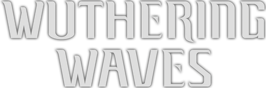

# Wuthering Waves asset reference

**Game version 3.8** · [Kuro Games update notice](https://wutheringwaves.kurogames.com/en/main/news/detail/5705)

## Categories

- [Characters](characters.md) — in-game names, export codenames, role IDs, and portraits.
- [Monsters](monsters.md) — monster IDs and head-icon names.
- [Weapons](weapons.md) — item IDs, model IDs, and UI textures by weapon type.

## License

[MIT](LICENSE) covers this repository’s original documentation and scripts. Game artwork, logos, and game data belong to their respective rights holders. The earlier [wuwa-ids](https://github.com/yuhkix/wuwa-ids) lists by Yuhki are linked for reference.
