[Home](README.md) · [Characters](characters.md) · [Monsters](monsters.md) · [Weapons](weapons.md)

# Monsters

Game version **3.8**. IDs identify game records. Multiple IDs can share a name, icon, or model. UI texture names are searchable in FModel.

| Portrait | In-game name | Monster ID | Head icon |
| --- | --- | --- | --- |
| 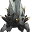 | Vanguard Junrock | `310000010` | `T_IconMonsterHead_015_UI` |
| 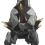 | Fission Junrock | `310000020` | `T_IconMonsterHead_025_UI` |
| 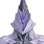 | Electro Predator | `310000030` | `T_IconMonsterHead_035_UI` |
| 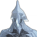 | Glacio Predator | `310000040` | `T_IconMonsterHead_105_UI` |
| 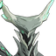 | Aero Predator | `310000050` | `T_IconMonsterHead_235_UI` |
| 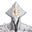 | Fusion Warrior | `310000060` | `T_IconMonsterHead_045_UI` |
| 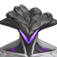 | Havoc Warrior | `310000070` | `T_IconMonsterHead_055_UI` |
| 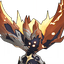 | Snip Snap | `310000080` | `T_IconMonsterHead_065_UI` |
| 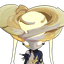 | Zig Zag | `310000090` | `T_IconMonsterHead_075_UI` |
| 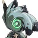 | Whiff Whaff | `310000100` | `T_IconMonsterHead_085_UI` |
| 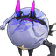 | Tick Tack | `310000110` | `T_IconMonsterHead_095_UI` |
| 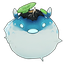 | Gulpuff | `310000120` | `T_IconMonsterHead_115_UI` |
| 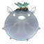 | Chirpuff | `310000130` | `T_IconMonsterHead_971_UI` |
| 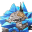 | Glacio Prism | `310000140` | `T_IconMonsterHead_145_UI` |
| 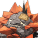 | Fusion Prism | `310000150` | `T_IconMonsterHead_155_UI` |
| 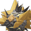 | Spectro Prism | `310000160` | `T_IconMonsterHead_165_UI` |
| 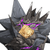 | Havoc Prism | `310000170` | `T_IconMonsterHead_175_UI` |
| 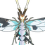 | Cruisewing | `310000180` | `T_IconMonsterHead_255_UI` |
| 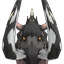 | Sabyr Boar | `310000190` | `T_IconMonsterHead_265_UI` |
| 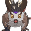 | Excarat | `310000200` | `T_IconMonsterHead_275_UI` |
| 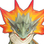 | Baby Viridblaze Saurian | `310000210` | `T_IconMonsterHead_285_UI` |
| 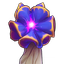 | Baby Roseshroom | `310000220` | `T_IconMonsterHead_305_UI` |
|  | Exile | `310000230` | `T_IconMonsterHead_977_UI` |
|  | Exile | `310000231` | `T_IconMonsterHead_977_UI` |
|  | Exile | `310000232` | `T_IconMonsterHead_977_UI` |
| 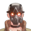 | Exile | `310000233` | `T_IconMonsterHead_977_UI` |
|  | Exile | `310000234` | `T_IconMonsterHead_977_UI` |
|  | Exile | `310000235` | `T_IconMonsterHead_977_UI` |
|  | Exile | `310000240` | `T_IconMonsterHead_976_UI` |
|  | Exile | `310000241` | `T_IconMonsterHead_976_UI` |
|  | Exile | `310000242` | `T_IconMonsterHead_976_UI` |
|  | Exile | `310000243` | `T_IconMonsterHead_976_UI` |
|  | Exile | `310000244` | `T_IconMonsterHead_976_UI` |
| 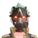 | Exile | `310000245` | `T_IconMonsterHead_976_UI` |
|  | Hooscamp Flinger | `310000250` | `T_IconMonsterHead_988_UI` |
| 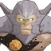 | Hooscamp | `310000251` | `T_IconMonsterHead_988_UI` |
| 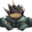 | Diamondclaw | `310000260` | `T_IconMonsterHead_987_UI` |
| 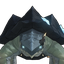 | Hoartoise | `310000270` | `T_IconMonsterHead_969_UI` |
| 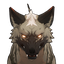 | Fusion Dreadmane | `310000280` | `T_IconMonsterHead_980_UI` |
| 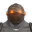 | Fractsidus Thruster | `310000290` | `T_IconMonsterHead_972_UI` |
|  | Hooscamp Clapperclaw | `310000300` | `T_IconMonsterHead_1002_UI` |
| 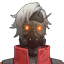 | Fractsidus Cannoneer | `310000310` | `T_IconMonsterHead_974_UI` |
| 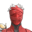 | Fractsidus Gunmaster | `310000320` | `T_IconMonsterHead_973_UI` |
| 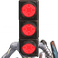 | Traffic Illuminator | `310000330` | `T_IconMonsterHead_1000_UI` |
| 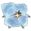 | Clang Bang | `310000340` | `T_IconMonsterHead_1001_UI` |
| 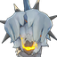 | Lava Larva | `310000350` | `T_IconMonsterHead_326_UI` |
| 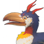 | Dwarf Cassowary | `310000360` | `T_IconMonsterHead_330_UI` |
| 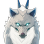 | Galescourge Stalker | `310000370` | `T_IconMonsterHead_31037_UI` |
| 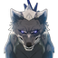 | Voltscourge Stalker | `310000380` | `T_IconMonsterHead_31038_UI` |
| 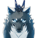 | Frostscourge Stalker | `310000390` | `T_IconMonsterHead_31039_UI` |
| 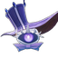 | Chop Chop: Headless | `310000400` | `T_IconMonsterHead_31040_UI` |
| 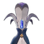 | Chop Chop: Leftless | `310000410` | `T_IconMonsterHead_31041_UI` |
| 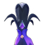 | Chop Chop: Rightless | `310000420` | `T_IconMonsterHead_31042_UI` |
| 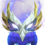 | Fae Ignis | `310000430` | `T_IconMonsterHead_31043_UI` |
|  | Nimbus Wraith | `310000440` | `T_IconMonsterHead_31044_UI` |
|  | Hocus Pocus | `310000450` | `T_IconMonsterHead_31045_UI` |
| 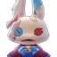 | Lottie Lost | `310000460` | `T_IconMonsterHead_31046_UI` |
|  | Diggy Duggy | `310000470` | `T_IconMonsterHead_31047_UI` |
| 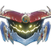 | Chest Mimic | `310000480` | `T_IconMonsterHead_31048_UI` |
| 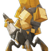 | Golden Junrock | `310000490` | `T_IconMonsterHead_31049_UI` |
| 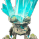 | Calcified Junrock | `310000500` | `T_IconMonsterHead_31050_UI` |
| 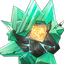 | Aero Prism | `310000510` | `T_IconMonsterHead_31051_UI` |
| 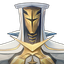 | La Guardia | `310000520` | `T_IconMonsterHead_31052_UI` |
| 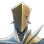 | Sagittario | `310000530` | `T_IconMonsterHead_31053_UI` |
|  | Sacerdos | `310000540` | `T_IconMonsterHead_31054_UI` |
| 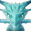 | Aero Drake | `310000550` | `T_IconMonsterHead_31055_UI` |
|  | Electro Drake | `310000560` | `T_IconMonsterHead_31056_UI` |
|  | Glacio Drake | `310000570` | `T_IconMonsterHead_31057_UI` |
|  | Fusion Drake | `310000580` | `T_IconMonsterHead_31058_UI` |
|  | Spectro Drake | `310000590` | `T_IconMonsterHead_31059_UI` |
|  | Havoc Drake | `310000600` | `T_IconMonsterHead_31060_UI` |
|  | Devotee's Flesh | `310000610` | `T_IconMonsterHead_31061_UI` |
|  | Abyssal Gunmaster | `310000620` | `T_IconMonsterHead_32035_UI` |
|  | Nightmare: Havoc Warrior | `310000630` | `T_IconMonsterHead_31063_UI` |
|  | Nightmare: Glacio Predator | `310000640` | `T_IconMonsterHead_31064_UI` |
|  | Nightmare: Electro Predator | `310000650` | `T_IconMonsterHead_31065_UI` |
|  | Nightmare: Aero Predator | `310000660` | `T_IconMonsterHead_31066_UI` |
|  | Nightmare: Gulpuff | `310000670` | `T_IconMonsterHead_31067_UI` |
|  | Nightmare: Chirpuff | `310000680` | `T_IconMonsterHead_31068_UI` |
|  | Midnight Ranger | `310000690` | `T_IconMonsterHead_31069_UI` |
|  | Midnight Ranger | `310000700` | `T_IconMonsterHead_31070_UI` |
|  | Gang Member | `310000710` | `T_IconMonsterHead_31071_UI` |
|  | Nightmare: Baby Viridblaze Saurian | `310000720` | `T_IconMonsterHead_31072_UI` |
|  | Nightmare: Baby Roseshroom | `310000730` | `T_IconMonsterHead_31073_UI` |
|  | Tremor Warrior | `310000740` | `T_IconMonsterHead_31074_UI` |
|  | Nightmare: Tick Tack | `310000750` | `T_IconMonsterHead_31075_UI` |
|  | Nightmare: Dwarf Cassowary | `310000760` | `T_IconMonsterHead_31076_UI` |
|  | Flora Drone | `310000770` | `T_IconMonsterHead_31077_UI` |
|  | Mining Drone | `310000780` | `T_IconMonsterHead_31078_UI` |
|  | Geospider S4 | `310000790` | `T_IconMonsterHead_31079_UI` |
|  | Outcast Executioner | `310000800` | `T_IconMonsterHead_31080_UI` |
|  | Thundstaff Outcast | `310000810` | `T_IconMonsterHead_31081_UI` |
|  | Zip Zap | `310000820` | `T_IconMonsterHead_31082_UI` |
|  | Iceglint Dancer | `310000830` | `T_IconMonsterHead_31083_UI` |
|  | Shadow Stepper | `310000840` | `T_IconMonsterHead_31084_UI` |
|  | Fractsidus Ripper | `310000850` | `T_IconMonsterHead_31085_UI` |
|  | Fractsidus Mawdoll | `310000860` | `T_IconMonsterHead_31086_UI` |
|  | Nightmare: Armed Corpo | `310000870` | `T_IconMonsterHead_31087_UI` |
|  | Nightmare: Security Corpo | `310000880` | `T_IconMonsterHead_31088_UI` |
|  | Nightmare: Spec Ops Corpo | `310000890` | `T_IconMonsterHead_31089_UI` |
|  | Smiter | `310000900` | `T_IconMonsterHead_31090_UI` |
|  | Porcelain Picket | `310000910` | `T_IconMonsterHead_31091_UI` |
|  | Stone Picket | `310000920` | `T_IconMonsterHead_31092_UI` |
|  | Aureate Picket | `310000930` | `T_IconMonsterHead_31093_UI` |
|  | Kernel Puppet: Joy | `310000940` | `T_IconMonsterHead_31094_UI` |
|  | Kernel Puppet: Anger | `310000950` | `T_IconMonsterHead_31095_UI` |
|  | Kernel Puppet: Worry | `310000960` | `T_IconMonsterHead_31096_UI` |
|  | Kernel Puppet: Reflection | `310000970` | `T_IconMonsterHead_31097_UI` |
|  | Kernel Puppet: Grief | `310000980` | `T_IconMonsterHead_31098_UI` |
|  | Kernel Puppet: Fright | `310000990` | `T_IconMonsterHead_31099_UI` |
|  | Fog Lionarch: Body | `310001000` | `T_IconMonsterHead_31100_UI` |
|  | Fog Lionarch: Head | `310001010` | `T_IconMonsterHead_31101_UI` |
|  | Smolder | `310001020` | `T_IconMonsterHead_31102_UI` |
|  | Jade Nether Serpent | `310001030` | `T_IconMonsterHead_31103_UI` |
|  | Bloomburst Puppet | `310001040` | `T_IconMonsterHead_31104_UI` |
|  | Stonewall Bracer | `320000010` | `T_IconMonsterHead_185_UI` |
|  | Violet-Feathered Heron | `320000020` | `T_IconMonsterHead_125_UI` |
|  | Cyan-Feathered Heron | `320000030` | `T_IconMonsterHead_135_UI` |
|  | Flautist | `320000040` | `T_IconMonsterHead_195_UI` |
|  | Tambourinist | `320000050` | `T_IconMonsterHead_205_UI` |
|  | Rocksteady Guardian | `320000060` | `T_IconMonsterHead_245_UI` |
|  | Chasm Guardian | `320000070` | `T_IconMonsterHead_215_UI` |
|  | Viridblaze Saurian | `320000080` | `T_IconMonsterHead_295_UI` |
|  | Roseshroom | `320000090` | `T_IconMonsterHead_315_UI` |
|  | Havoc Dreadmane | `320000100` | `T_IconMonsterHead_984_UI` |
|  | Hoochief Cyclone | `320000110` | `T_IconMonsterHead_989_UI` |
|  | Hoochief | `320000111` | `T_IconMonsterHead_989_UI` |
|  | Spearback | `320000120` | `T_IconMonsterHead_986_UI` |
|  | Carapace | `320000130` | `T_IconMonsterHead_970_UI` |
|  | Exile Leader | `320000140` | `T_IconMonsterHead_979_UI` |
|  | Exile Technician | `320000150` | `T_IconMonsterHead_978_UI` |
|  | Fractsidus Executioner | `320000160` | `T_IconMonsterHead_975_UI` |
|  | Hoochief Menace | `320000170` | `T_IconMonsterHead_1005_UI` |
|  | Autopuppet Scout | `320000180` | `T_IconMonsterHead_1003_UI` |
|  | Glacio Dreadmane | `320000190` | `T_IconMonsterHead_985_UI` |
|  | Lumiscale Construct | `320000200` | `T_IconMonsterHead_329_UI` |
|  | Lightcrusher | `320000210` | `T_IconMonsterHead_328_UI` |
|  | Questless Knight | `320000220` | `T_IconMonsterHead_32022_UI` |
|  | Diurnus Knight | `320000230` | `T_IconMonsterHead_32023_UI` |
|  | Nocturnus Knight | `320000240` | `T_IconMonsterHead_32024_UI` |
|  | Abyssal Patricius | `320000250` | `T_IconMonsterHead_32025_UI` |
|  | Abyssal Gladius | `320000260` | `T_IconMonsterHead_32026_UI` |
|  | Abyssal Mercator | `320000270` | `T_IconMonsterHead_32027_UI` |
|  | Chop Chop | `320000280` | `T_IconMonsterHead_32028_UI` |
|  | Vitreum Dancer | `320000290` | `T_IconMonsterHead_32029_UI` |
|  | Cuddle Wuddle | `320000300` | `T_IconMonsterHead_32030_UI` |
|  | Rage Against the Statue | `320000310` | `T_IconMonsterHead_32031_UI` |
|  | Hurriclaw | `320000320` | `T_IconMonsterHead_32032_UI` |
|  | Capitaneus | `320000330` | `T_IconMonsterHead_32033_UI` |
|  | Kerasaur | `320000340` | `T_IconMonsterHead_31062_UI` |
|  | Pilgrim's Shell | `320000350` | `T_IconMonsterHead_32034_UI` |
|  | Flamecrest Gladiator | `320000360` | `T_IconMonsterHead_32036_UI` |
|  | Galecrest Gladiator | `320000370` | `T_IconMonsterHead_32037_UI` |
|  | Lightcrest Gladiator | `320000380` | `T_IconMonsterHead_32038_UI` |
|  | Frostcrest Gladiator | `320000390` | `T_IconMonsterHead_32039_UI` |
|  | Thundercrest Gladiator | `320000400` | `T_IconMonsterHead_32040_UI` |
|  | Abysscrest Gladiator | `320000410` | `T_IconMonsterHead_32041_UI` |
|  | Fractsidus Inspector | `320000420` | `T_IconMonsterHead_32042_UI` |
|  | Nightmare: Tambourinist | `320000430` | `T_IconMonsterHead_32043_UI` |
|  | Corrosaurus | `320000440` | `T_IconMonsterHead_32044_UI` |
|  | Nightmare: Violet-Feathered Heron | `320000450` | `T_IconMonsterHead_32045_UI` |
|  | Nightmare: Cyan-Feathered Heron | `320000460` | `T_IconMonsterHead_32046_UI` |
|  | Nightmare: Viridblaze Saurian | `320000470` | `T_IconMonsterHead_32047_UI` |
|  | Nightmare: Roseshroom | `320000480` | `T_IconMonsterHead_32048_UI` |
|  | Twin Nova: Nebulous Cannon | `320000490` | `T_IconMonsterHead_32049_UI` |
|  | Twin Nova: Collapsar Blade | `320000500` | `T_IconMonsterHead_32050_UI` |
|  | Flora Reindeer | `320000510` | `T_IconMonsterHead_32051_UI` |
|  | Mining Reindeer | `320000520` | `T_IconMonsterHead_32052_UI` |
|  | Ironhoof | `320000530` | `T_IconMonsterHead_32053_UI` |
|  | Spacetrek Explorer | `320000540` | `T_IconMonsterHead_32054_UI` |
|  | Sabercat Reaver | `320000550` | `T_IconMonsterHead_32055_UI` |
|  | Sabercat Prowler | `320000560` | `T_IconMonsterHead_32056_UI` |
|  | Frostbite Coleoid | `320000570` | `T_IconMonsterHead_32057_UI` |
|  | Windlash Coleoid | `320000580` | `T_IconMonsterHead_32058_UI` |
|  | Kronablight | `320000590` | `T_IconMonsterHead_32059_UI` |
|  | Kronaclaw | `320000600` | `T_IconMonsterHead_32060_UI` |
|  | Reminiscence: Kronaclaw | `320000601` | `T_IconMonsterHead_32060_UI` |
|  | Glommoth | `320000610` | `T_IconMonsterHead_32061_UI` |
|  | Fractsidus Milliner | `320000620` | `T_IconMonsterHead_32062_UI` |
|  | Phagosite: Bipolarch | `320000630` | `T_IconMonsterHead_32063_UI` |
|  | Phagosite: Hysterarch | `320000640` | `T_IconMonsterHead_32064_UI` |
|  | Phagosite: Miserarch | `320000650` | `T_IconMonsterHead_32065_UI` |
|  | Voidwing Moth | `320000660` | `T_IconMonsterHead_32066_UI` |
|  | Fog Lionarch | `320000670` | `T_IconMonsterHead_32067_UI` |
|  | Forbidden Bastion | `320000680` | `T_IconMonsterHead_32068_UI` |
|  | Skywatch Lancer | `320000690` | `T_IconMonsterHead_32069_UI` |
|  | Formrender | `320000700` | `T_IconMonsterHead_32070_UI` |
|  | Soulfrayer | `320000710` | `T_IconMonsterHead_32071_UI` |
|  | Tempest Mephis | `330000010` | `T_IconMonsterHead_225_UI` |
|  | Inferno Rider | `330000020` | `T_IconMonsterHead_325_UI` |
|  | Impermanence Heron | `330000030` | `T_IconMonsterHead_995_UI` |
|  | Lampylumen Myriad | `330000040` | `T_IconMonsterHead_994_UI` |
|  | Feilian Beringal | `330000050` | `T_IconMonsterHead_996_UI` |
|  | Mourning Aix | `330000060` | `T_IconMonsterHead_997_UI` |
|  | Fallacy of No Return | `330000070` | `T_IconMonsterHead_350_UI` |
|  | Scar: Lightbane Reversal | `330000100` | `T_IconMonsterHead_1004_UI` |
|  | Lorelei | `330000110` | `T_IconMonsterHead_33011_UI` |
|  | Lorelei | `330000111` | `T_IconMonsterHead_33011_UI` |
|  | Sentry Construct | `330000120` | `T_IconMonsterHead_33012_UI` |
|  | Dragon of Dirge | `330000130` | `T_IconMonsterHead_33013_UI` |
|  | Dragon of Dirge | `330000131` | `T_IconMonsterHead_33013_UI` |
|  | Nightmare: Feilian Beringal | `330000140` | `T_IconMonsterHead_YZ_33014_UI` |
|  | Nightmare: Impermanence Heron | `330000150` | `T_IconMonsterHead_YZ_33015_UI` |
|  | Nightmare: Thundering Mephis | `330000160` | `T_IconMonsterHead_YZ_33016_UI` |
|  | Nightmare: Tempest Mephis | `330000170` | `T_IconMonsterHead_YZ_33017_UI` |
|  | Nightmare: Crownless | `330000180` | `T_IconMonsterHead_YZ_33018_UI` |
|  | Nightmare: Inferno Rider | `330000190` | `T_IconMonsterHead_YZ_33019_UI` |
|  | Nightmare: Mourning Aix | `330000200` | `T_IconMonsterHead_YZ_33020_UI` |
|  | Crownless | `340000010` | `T_IconMonsterHead_999_UI` |
|  | Bell-Borne Geochelone | `340000020` | `T_IconMonsterHead_992_UI` |
|  | Scar: Aberrant Nightmare | `340000050` | `T_IconMonsterHead_990_UI` |
|  | Mech Abomination | `340000060` | `T_IconMonsterHead_993_UI` |
|  | Dreamless | `340000070` | `T_IconMonsterHead_998_UI` |
|  | Thundering Mephis | `340000080` | `T_IconMonsterHead_226_UI` |
|  | Jué | `340000090` | `T_IconMonsterHead_327_UI` |
|  | Hecate | `340000100` | `T_IconMonsterHead_34010_1_UI` |
|  | Hecate | `340000101` | `T_IconMonsterHead_34010_1_UI` |
|  | Nightmare: Kelpie | `340000110` | `T_IconMonsterHead_33021_UI` |
|  | — | `340000111` | `T_IconMonsterHead_33021_UI` |
|  | Kelpie | `340000112` | `T_IconMonsterHead_33021_UI` |
|  | Phantom of Sunken Reverie | `340000113` | `T_IconMonsterHead_33021_UI` |
|  | Fleurdelys | `340000120` | `T_IconMonsterHead_34012_UI` |
|  | Reminiscence: Fleurdelys | `340000121` | `T_IconMonsterHead_34012_1_UI` |
|  | Fleurdelys | `340000122` | `T_IconMonsterHead_34012_UI` |
|  | Vessel of the Fallen Dream | `340000123` | `T_IconMonsterHead_34012_UI` |
|  | Nightmare: Lampylumen Myriad | `340000130` | `T_IconMonsterHead_34013_UI` |
|  | Lioness of Glory | `340000140` | `T_IconMonsterHead_33022_UI` |
|  | Lioness of Glory | `340000141` | `T_IconMonsterHead_QX_33022_UI` |
|  | Apex Champion of the Citadel | `340000142` | `T_IconMonsterHead_33022_UI` |
|  | Fenrico | `340000150` | `T_IconMonsterHead_34015_UI` |
|  | Reminiscence: Fenrico | `340000151` | `T_IconMonsterHead_34015_2_UI` |
|  | Nightmare: Hecate | `340000160` | `T_IconMonsterHead_34016_UI` |
|  | The False Sovereign | `340000170` | `T_IconMonsterHead_34017_UI` |
|  | The False Sovereign | `340000171` | `T_IconMonsterHead_QX_34017_UI` |
|  | Eternal Husk of Sovereign | `340000172` | `T_IconMonsterHead_34017_UI` |
|  | Lady of the Sea | `340000180` | `T_IconMonsterHead_34018_UI` |
|  | Lady of the Sea | `340000181` | `T_IconMonsterHead_34018_UI` |
|  | Hecate | `340000190` | `T_IconMonsterHead_34010_UI` |
|  | Threnodian: Leviathan | `340000200` | `T_IconMonsterHead_34020_UI` |
|  | Reminiscence: Threnodian - Leviathan | `340000201` | `T_IconMonsterHead_34020_1_UI` |
|  | Hyvatia | `340000210` | `T_IconMonsterHead_34021_UI` |
|  | Hyvatia | `340000211` | `T_IconMonsterHead_34021_1_UI` |
|  | Star Gazer of Silent Void | `340000212` | `T_IconMonsterHead_34021_UI` |
|  | Star Gazer of Silent Void | `340000213` | `T_IconMonsterHead_34021_UI` |
|  | Reactor Husk | `340000220` | `T_IconMonsterHead_34022_UI` |
|  | Feral Meltdown | `340000221` | `T_IconMonsterHead_34022_UI` |
|  | Feral Meltdown | `340000222` | `T_IconMonsterHead_34022_UI` |
|  | Fallacy of No Return | `340000230` | `T_IconMonsterHead_34023_UI` |
|  | Voidworm | `340000240` | `T_IconMonsterHead_34024_UI` |
|  | Sigillum | `340000250` | `T_IconMonsterHead_34025_UI` |
|  | Sigillum | `340000251` | `T_IconMonsterHead_34025_0_UI` |
|  | Stellar Wayfarer | `340000252` | `T_IconMonsterHead_34025_0_UI` |
|  | Nameless Explorer | `340000260` | `T_IconMonsterHead_34026_UI` |
|  | Desolate Apparition | `340000261` | `T_IconMonsterHead_34026_UI` |
|  | Aleph-1's Creation | `340000270` | `T_IconMonsterHead_34027_UI` |
|  | Reminiscence: Threnodian - Voidborne Construct | `340000271` | `T_IconMonsterHead_34027_UI` |
|  | Denia | `340000280` | `T_IconMonsterHead_34028_UI` |
|  | Reminiscence: Denia | `340000281` | `T_IconMonsterHead_34028_1_UI` |
|  | Nightmare: Adam Smasher | `340000290` | `T_IconMonsterHead_34029_UI` |
|  | Reminiscence - Nightmare: Adam Smasher | `340000291` | `T_IconMonsterHead_34029_1_UI` |
|  | Myriad Snare: Rustfire Chassis | `340000300` | `T_IconMonsterHead_34030_UI` |
|  | Thousand-Puppet Pavilion | `340000310` | `T_IconMonsterHead_34031_UI` |
|  | Calamity Effigy | `340000320` | `T_IconMonsterHead_34032_UI` |
|  | Suhsin the Inevitable | `340000330` | `T_IconMonsterHead_34033_UI` |
|  | Suhsin the Inevitable | `340000331` | `T_IconMonsterHead_34033_1_UI` |
|  | Reminiscence: Suhsin the Inevitable | `340000332` | `T_IconMonsterHead_34033_2_UI` |
|  | Phantom: Mourning Aix | `350000010` | `T_IconMonsterHead_1006_UI` |
|  | Phantom: Rocksteady Guardian | `350000020` | `T_IconMonsterHead_1007_UI` |
|  | Phantom: Hoartoise | `350000030` | `T_IconMonsterHead_1010_UI` |
|  | Phantom: Thundering Mephis | `350000040` | `T_IconMonsterHead_1008_UI` |
|  | Phantom: Feilian Beringal | `350000050` | `T_IconMonsterHead_1009_UI` |
|  | Phantom: Impermanence Heron | `350000060` | `T_IconMonsterHead_1014_UI` |
|  | Phantom: Clang Bang | `350000070` | `T_IconMonsterHead_1015_UI` |
|  | Phantom: Lightcrusher | `350000080` | `T_IconMonsterHead_1016_UI` |
|  | Phantom: Dreamless | `350000090` | `T_IconMonsterHead_998_1_UI` |
|  | Phantom: Gulpuff | `350000100` | `T_IconMonsterHead_115_1_UI` |
|  | Phantom: Lumiscale Construct | `350000110` | `T_IconMonsterHead_329_1_UI` |
|  | Phantom: Inferno Rider | `350000120` | `T_IconMonsterHead_325_1_UI` |
|  | Phantom: Diggy Duggy | `350000130` | `T_IconMonsterHead_SG_31047_UI` |
|  | Phantom: Vitreum Dancer | `350000140` | `T_IconMonsterHead_SG_32029_UI` |
|  | Phantom: Questless Knight | `350000150` | `T_IconMonsterHead_SG_32022_UI` |
|  | Phantom: Sentry Construct | `350000160` | `T_IconMonsterHead_SG_33009_UI` |
|  | Phantom: Lorelei | `350000170` | `T_IconMonsterHead_SG_33011_UI` |
|  | Phantom: Capitaneus | `350000180` | `T_IconMonsterHead_32033_1_UI` |
|  | Phantom: Nimbus Wraith | `350000190` | `T_IconMonsterHead_SG_31044_UI` |
|  | Phantom: Crownless | `350000200` | `T_IconMonsterHead_SG_9991_UI` |
|  | Phantom: Nightmare Crownless | `350000210` | `T_IconMonsterHead_SG_33018_UI` |
|  | Phantom: Chest Mimic | `350000220` | `T_IconMonsterHead_SG_31048_UI` |
|  | Phantom: Fae Ignis | `350000230` | `T_IconMonsterHead_SG_31043_UI` |
|  | Phantom: Cuddle Wuddle | `350000240` | `T_IconMonsterHead_SG_32030_UI` |
|  | Phantom: Nightmare Inferno Rider | `350000250` | `T_IconMonsterHead_SG_33019_UI` |
|  | Phantom: Nightmare Mourning Aix | `350000260` | `T_IconMonsterHead_SG_33020_UI` |
|  | Phantom: Fallacy of No Return | `350000270` | `T_IconMonsterHead_SG_350_UI` |
|  | Phantom: Kerasaur | `350000280` | `T_IconMonsterHead_SG_31062_UI` |
| — | Phantom: Lioness of Glory | `350000290` | `T_IconMonsterHead_SG_33022_UI` |
|  | Phantom: Chop Chop | `350000300` | `T_IconMonsterHead_SG_32028_UI` |
|  | Phantom: The False Sovereign | `350000310` | `T_IconMonsterHead_SG_34017_UI` |
|  | Phantom: Zip Zap | `350000330` | `T_IconMonsterHead_SG_31082_UI` |
|  | Phantom: Twin Nova - Nebulous Cannon | `350000340` | `T_IconMonsterHead_SG_32049_UI` |
|  | Phantom: Twin Nova - Collapsar Blade | `350000350` | `T_IconMonsterHead_SG_32050_UI` |
|  | Phantom: Sigillum | `350000360` | `T_IconMonsterHead_SG_34025_UI` |
|  | Phantom: Iceglint Dancer | `350000370` | `T_IconMonsterHead_SG_31083_UI` |
|  | Phantom: Reactor Husk | `350000380` | `T_IconMonsterHead_SG_34022_UI` |
|  | Phantom: Kronaclaw | `350000390` | `T_IconMonsterHead_SG_32060_UI` |
|  | Phantom: Glommoth | `350000400` | `T_IconMonsterHead_SG_32061_UI` |
|  | Phantom: Forbidden Bastion | `350000410` | `T_IconMonsterHead_SG_32068_UI` |
|  | Phantom: Smiter | `350000420` | `T_IconMonsterHead_SG_31090_UI` |
|  | Phantom: Myriad Snare: Rustfire Chassis | `350000430` | `T_IconMonsterHead_SG_34030_UI` |
|  | Phantom: Smolder | `350000440` | `T_IconMonsterHead_SG_31102_UI` |
| — | Stay tuned | `350000450` | `T_IconMonsterHead_SG_34033_2_UI` |
|  | Phantom: Skywatch Lancer | `350000460` | `T_IconMonsterHead_SG_32069_UI` |

## Verified artwork paths

| In-game name | Export path |
| --- | --- |
| Fleurdelys | `Aki/UI/UIResources/Common/Image/ImgBoss/T_Boss_34012` |
| Fractsidus Ripper | `Aki/UI/UIResources/Common/Image/IconMonsterHead/T_IconMonsterHead_31085_UI` |

Sources: [3.8 monster names and icons](https://static.nanoka.cc/ww/3.8/monster.json) · [Monster configuration](https://github.com/Arikatsu/WutheringWaves_Data/blob/a96f6c6e87717d528a340de37374d9fc5a5ba563/BinData/monster_Info/monsterinfo.json) · [Earlier ID list by Yuhki](https://github.com/yuhkix/wuwa-ids/blob/main/monsters.md).
