[Home](README.md) · [Characters](characters.md) · [Monsters](monsters.md) · [Weapons](weapons.md)

# Weapons

Game version **3.8**. Item IDs and model IDs come from separate fields. UI icon names can be searched in FModel.

## Broadblades

| Portrait | In-game name | Item ID | Model ID | UI texture |
| --- | --- | --- | --- | --- |
|  | Training Broadblade | `21010011` | `21010011` | `T_IconWeapon21010011_UI` |
| 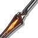 | Tyro Broadblade | `21010012` | `21010012` | `T_IconWeapon21010012_UI` |
| 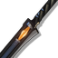 | Broadblade of Night | `21010013` | `21010013` | `T_IconWeapon21010013_UI` |
| 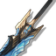 | Lustrous Razor | `21010015` | `21010015` | `T_IconWeapon21010015_UI` |
| 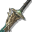 | Verdant Summit | `21010016` | `21010016` | `T_IconWeapon21010016_UI` |
|  | Originite: Type I | `21010023` | `21010023` | `T_IconWeapon21010023_UI` |
| 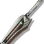 | Discord | `21010024` | `21010024` | `T_IconWeapon21010024_UI` |
| 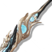 | Ages of Harvest | `21010026` | `21010026` | `T_IconWeapon21010026_UI` |
| 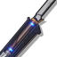 | Broadblade#41 | `21010034` | `21010034` | `T_IconWeapon21010034_UI` |
| 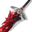 | Wildfire Mark | `21010036` | `21010036` | `T_IconWeapon21010036_UI` |
| 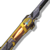 | Broadblade of Voyager | `21010043` | `21010043` | `T_IconWeapon21010043_UI` |
| 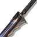 | Dauntless Evernight | `21010044` | `21010044` | `T_IconWeapon21010044_UI` |
| 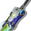 | Radiance Cleaver | `21010045` | `21010045` | `T_IconWeapon_21010045_UI` |
| 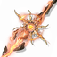 | Thunderflare Dominion | `21010046` | `21010046` | `T_IconWeapon21010046_UI` |
| 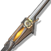 | Guardian Broadblade | `21010053` | `21010053` | `T_IconWeapon21010053_UI` |
|  | Kumokiri | `21010056` | `21010056` | `T_IconWeapon21010056_UI` |
| 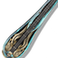 | Beguiling Melody | `21010063` | `21010063` | `T_IconWeapon21010063_UI` |
| 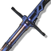 | Helios Cleaver | `21010064` | `21010064` | `T_IconWeapon21010064_UI` |
|  | Starfield Calibrator | `21010066` | `21010066` | `T_IconWeapon21010066_UI` |
| 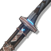 | Autumntrace | `21010074` | `21010074` | `T_IconWeapon21010074_UI` |
| 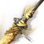 | Thousandfold Deliverance | `21010076` | `21010076` | `T_IconWeapon21010076_UI` |
| 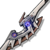 | Waning Redshift | `21010084` | `21010084` | `T_IconWeapon21010084_UI` |
| 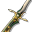 | Meditations on Mercy | `21010094` | `21010094` | `T_IconWeapon21010094_UI` |
|  | Aureate Zenith | `21010104` | `21010104` | `T_IconWeapon21010104_UI` |
|  | Projection: Formless Broadblade | `80080002` | — | `T_IconWeapon21010027_UI` |
| 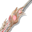 | Projection - Peach Blossom | `80080007` | — | `T_IconWeapon21010017_UI` |

## Swords

| Portrait | In-game name | Item ID | Model ID | UI texture |
| --- | --- | --- | --- | --- |
| 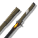 | Training Sword | `21020011` | `21020011` | `T_IconWeapon21020011_UI` |
| 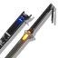 | Tyro Sword | `21020012` | `21020012` | `T_IconWeapon21020012_UI` |
| 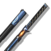 | Sword of Night | `21020013` | `21020013` | `T_IconWeapon21020013_UI` |
| 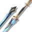 | Emerald of Genesis | `21020015` | `21020015` | `T_IconWeapon21020015_UI` |
| 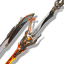 | Blazing Brilliance | `21020016` | `21020016` | `T_IconWeapon21020016_UI` |
|  | Somnoire Anchor | `21020017` | `21020017` | `T_IconWeapon21020019_UI` |
| 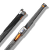 | Originite: Type II | `21020023` | `21020023` | `T_IconWeapon21020023_UI` |
| 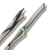 | Overture | `21020024` | `21020024` | `T_IconWeapon21020024_UI` |
| 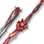 | Red Spring | `21020026` | `21020026` | `T_IconWeapon21020017_UI` |
| 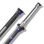 | Sword#18 | `21020034` | `21020034` | `T_IconWeapon21020034_UI` |
| 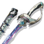 | Unflickering Valor | `21020036` | `21020036` | `T_IconWeapon21020025_UI` |
| 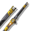 | Sword of Voyager | `21020043` | `21020043` | `T_IconWeapon21020043_UI` |
| 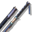 | Commando of Conviction | `21020044` | `21020044` | `T_IconWeapon21020044_UI` |
|  | Laser Shearer | `21020045` | `21020045` | `T_IconWeapon_21020045_UI` |
| 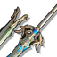 | Bloodpact's Pledge | `21020046` | `21020046` | `T_IconWeapon21020026_UI` |
| 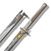 | Guardian Sword | `21020053` | `21020053` | `T_IconWeapon21020053_UI` |
| 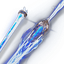 | Defier's Thorn | `21020056` | `21020056` | `T_IconWeapon21020056_UI` |
| 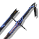 | Lunar Cutter | `21020064` | `21020064` | `T_IconWeapon21020064_UI` |
| 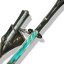 | Emerald Sentence | `21020066` | `21020066` | `T_IconWeapon21020066_UI` |
| 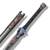 | Lumingloss | `21020074` | `21020074` | `T_IconWeapon21020074_UI` |
| 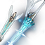 | Everbright Polestar | `21020076` | `21020076` | `T_IconWeapon21020076_UI` |
| 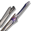 | Endless Collapse | `21020084` | `21020084` | `T_IconWeapon21020084_UI` |
| 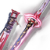 | Frostburn | `21020086` | `21020086` | `T_IconWeapon21020086_UI` |
| 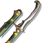 | Fables of Wisdom | `21020094` | `21020094` | `T_IconWeapon21020094_UI` |
| 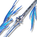 | Azure Oath | `21020096` | `21020096` | `T_IconWeapon21020096_UI` |
| 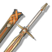 | Feather Edge | `21020104` | `21020104` | `T_IconWeapon21020104_UI` |
| 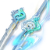 | Glint of Clouds | `21020106` | `21020106` | `T_IconWeapon21020106_UI` |
|  | Unspoken Rue | `21020107` | `21020107` | `T_IconWeapon21020107_UI` |
| 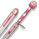 | Projection: Somnoire Anchor | `80080001` | — | `T_IconWeapon21020019_UI` |
| 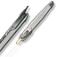 | Projection: Formless Sword | `80080003` | — | `T_IconWeapon21020018_UI` |
| 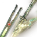 | Projection: Blade of a Thousand Arts | `80080009` | — | `T_IconWeapon80080009_UI` |

## Pistols

| Portrait | In-game name | Item ID | Model ID | UI texture |
| --- | --- | --- | --- | --- |
| 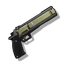 | Training Pistols | `21030011` | `21030011` | `T_IconWeapon21030011_UI` |
| 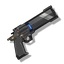 | Tyro Pistols | `21030012` | `21030012` | `T_IconWeapon21030012_UI` |
|  | Pistols of Night | `21030013` | `21030013` | `T_IconWeapon21030013_UI` |
|  | Static Mist | `21030015` | `21030015` | `T_IconWeapon21030015_UI` |
|  | The Last Dance | `21030016` | `21030016` | `T_IconWeapon21030017_UI` |
|  | Originite: Type III | `21030023` | `21030023` | `T_IconWeapon21030023_UI` |
|  | Cadenza | `21030024` | `21030024` | `T_IconWeapon21030024_UI` |
|  | Woodland Aria | `21030026` | `21030026` | `T_IconWeapon21030026_UI` |
|  | Pistols#26 | `21030034` | `21030034` | `T_IconWeapon21030034_UI` |
|  | Lux & Umbra | `21030036` | `21030036` | `T_IconWeapon21030036_UI` |
|  | Pistols of Voyager | `21030043` | `21030043` | `T_IconWeapon21030043_UI` |
|  | Undying Flame | `21030044` | `21030044` | `T_IconWeapon21030044_UI` |
|  | Phasic Homogenizer | `21030045` | `21030045` | `T_IconWeapon_21030045_UI` |
|  | Spectrum Blaster | `21030046` | `21030046` | `T_IconWeapon21030046_UI` |
|  | Guardian Pistols | `21030053` | `21030053` | `T_IconWeapon21030053_UI` |
|  | Spectral Trigger | `21030056` | `21030056` | `T_IconWeapon21030056_UI` |
|  | Novaburst | `21030064` | `21030064` | `T_IconWeapon21030064_UI` |
|  | Skull Thrasher | `21030066` | `21030066` | `T_IconWeapon21030066_UI` |
|  | Thunderbolt | `21030074` | `21030074` | `T_IconWeapon21030074_UI` |
|  | Lullaby | `21030076` | `21030076` | `T_IconWeapon21030076_UI` |
|  | Relativistic Jet | `21030084` | `21030084` | `T_IconWeapon21030084_UI` |
|  | Romance in Farewell | `21030094` | `21030094` | `T_IconWeapon21030094_UI` |
|  | Solar Flame | `21030104` | `21030104` | `T_IconWeapon21030104_UI` |
|  | Projection: Formless Pistol | `80080004` | — | `T_IconWeapon21030016_UI` |

## Gauntlets

| Portrait | In-game name | Item ID | Model ID | UI texture |
| --- | --- | --- | --- | --- |
|  | Training Gauntlets | `21040011` | `21140011` | `T_IconWeapon21040011_UI` |
|  | Tyro Gauntlets | `21040012` | `21140012` | `T_IconWeapon21040012_UI` |
|  | Gauntlets of Night | `21040013` | `21140013` | `T_IconWeapon21040013_UI` |
|  | Abyss Surges | `21040015` | `21140015` | `T_IconWeapon21040015_UI` |
|  | Verity's Handle | `21040016` | `21040016` | `T_IconWeapon21040016_UI` |
|  | Originite: Type IV | `21040023` | `21140023` | `T_IconWeapon21040023_UI` |
|  | Marcato | `21040024` | `21140024` | `T_IconWeapon21040024_UI` |
|  | Tragicomedy | `21040026` | `21040026` | `T_IconWeapon21040018_UI` |
|  | Gauntlets#21D | `21040034` | `21140034` | `T_IconWeapon21040034_UI` |
|  | Blazing Justice | `21040036` | `21040036` | `T_IconWeapon21040019_UI` |
|  | Gauntlets of Voyager | `21040043` | `21140043` | `T_IconWeapon21040043_UI` |
|  | Amity Accord | `21040044` | `21140044` | `T_IconWeapon21040044_UI` |
|  | Pulsation Bracer | `21040045` | `21040045` | `T_IconWeapon_21040045_UI` |
|  | Moongazer's Sigil | `21040046` | `21040046` | `T_IconWeapon21040046_UI` |
|  | Guardian Gauntlets | `21040053` | `21140053` | `T_IconWeapon21040053_UI` |
|  | Daybreaker's Spine | `21040056` | `21040056` | `T_IconWeapon_21040056_UI` |
|  | Hollow Mirage | `21040064` | `21140064` | `T_IconWeapon21040064_UI` |
|  | Solsworn Ciphers | `21040066` | `21040066` | `T_IconWeapon21040066_UI` |
|  | Stonard | `21040074` | `21140074` | `T_IconWeapon21040074_UI` |
|  | Celestial Spiral | `21040084` | `21140084` | `T_IconWeapon21040084_UI` |
|  | Legend of Drunken Hero | `21040094` | `21040094` | `T_IconWeapon21040094_UI` |
|  | Aether Strike | `21040104` | `21040104` | `T_IconWeapon21040104_UI` |
|  | Projection: Formless Gauntlets | `80080005` | — | `T_IconWeapon21040017_UI` |

## Rectifiers

| Portrait | In-game name | Item ID | Model ID | UI texture |
| --- | --- | --- | --- | --- |
|  | Training Rectifier | `21050011` | `21050011` | `T_IconWeapon21050011_UI` |
|  | Tyro Rectifier | `21050012` | `21050012` | `T_IconWeapon21050012_UI` |
|  | Rectifier of Night | `21050013` | `21050013` | `T_IconWeapon21050013_UI` |
|  | Cosmic Ripples | `21050015` | `21050015` | `T_IconWeapon21050015_UI` |
|  | Stringmaster | `21050016` | `21050016` | `T_IconWeapon21050016_UI` |
|  | Call of the Abyss | `21050017` | `21050017` | `T_IconWeapon21050017_UI` |
|  | Originite: Type V | `21050023` | `21050023` | `T_IconWeapon21050023_UI` |
|  | Variation | `21050024` | `21050024` | `T_IconWeapon21050024_UI` |
|  | Rime-Draped Sprouts | `21050026` | `21050026` | `T_IconWeapon21050026_UI` |
|  | Ocean's Gift | `21050027` | `21050027` | `T_IconWeapon21050036_UI` |
|  | Rectifier#25 | `21050034` | `21050034` | `T_IconWeapon21050034_UI` |
|  | Stellar Symphony | `21050036` | `21050036` | `T_IconWeapon21050027_UI` |
|  | Rectifier of Voyager | `21050043` | `21050043` | `T_IconWeapon21050043_UI` |
|  | Jinzhou Keeper | `21050044` | `21050044` | `T_IconWeapon21050044_UI` |
|  | Boson Astrolabe | `21050045` | `21050045` | `T_IconWeapon_21050045_UI` |
|  | Luminous Hymn | `21050046` | `21050046` | `T_IconWeapon21050029_UI` |
|  | Guardian Rectifier | `21050053` | `21050053` | `T_IconWeapon21050053_UI` |
|  | Whispers of Sirens | `21050056` | `21050056` | `T_IconWeapon21050030_UI` |
|  | Comet Flare | `21050064` | `21050064` | `T_IconWeapon21050064_UI` |
|  | Lethean Elegy | `21050066` | `21050066` | `T_IconWeapon21050066_UI` |
|  | Augment | `21050074` | `21050074` | `T_IconWeapon21050074_UI` |
|  | Forged Dwarf Star | `21050076` | `21050076` | `T_IconWeapon21050076_UI` |
|  | Fusion Accretion | `21050084` | `21050084` | `T_IconWeapon21050084_UI` |
|  | Freeze Frame | `21050086` | `21050086` | `T_IconWeapon21050086_UI` |
|  | Waltz in Masquerade | `21050094` | `21050094` | `T_IconWeapon21050094_UI` |
|  | Firstlight's Herald | `21050096` | `21050096` | `T_IconWeapon21050096_UI` |
|  | Radiant Dawn | `21050104` | `21050104` | `T_IconWeapon21050104_UI` |
|  | Blooming Jadehaven | `21050116` | `21050116` | `T_IconWeapon21050116_UI` |
|  | Projection: Formless Rectifier | `80080006` | — | `T_IconWeapon21050028_UI` |
|  | Projection: Ocean's Gift | `80080008` | — | `T_IconWeapon21050036_UI` |

Sources: [3.8 weapon names and icons](https://static.nanoka.cc/ww/3.8/weapon.json) · [Weapon configuration](https://github.com/Arikatsu/WutheringWaves_Data/blob/a96f6c6e87717d528a340de37374d9fc5a5ba563/BinData/weapon/weaponconf.json) · [Earlier ID list by Yuhki](https://github.com/yuhkix/wuwa-ids/blob/main/weapons.md).
